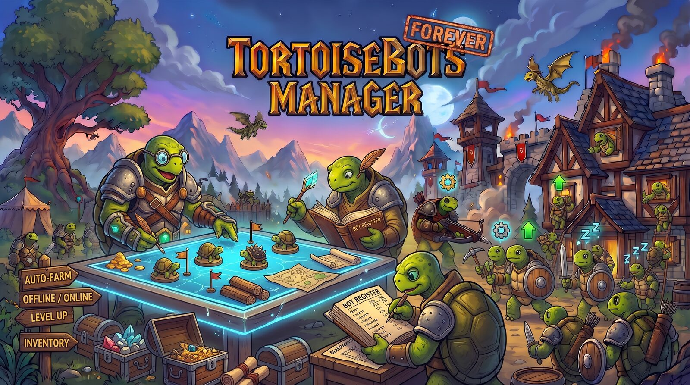
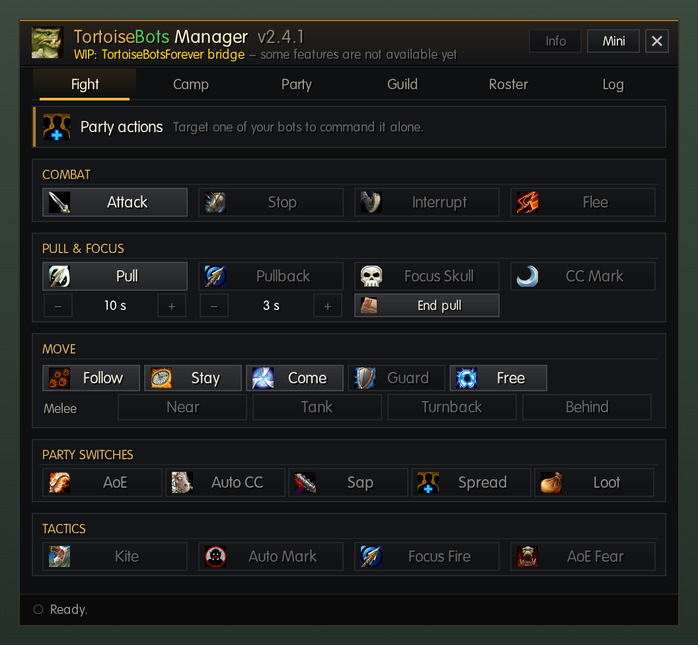
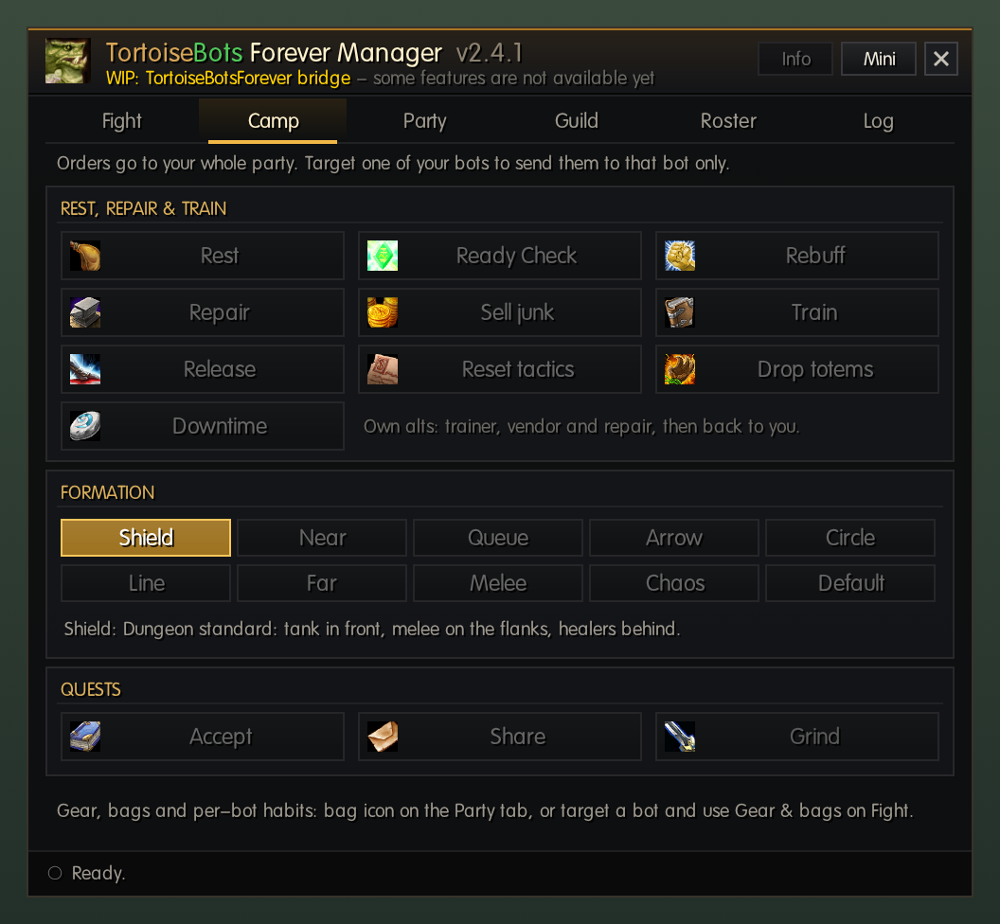

# TortoiseBotsForeverManager

> [!WARNING]
> **Work in progress.** Many features do not work yet. The server side,
> [TortoiseBotsForever](https://github.com/TortoiseBots/TortoiseBotsForever), is still being ported, so the addon
> greys out everything the server cannot do yet. Hover a grey button: it says **Not currently available**.

The in-game control panel (`/tbfm`) for **TortoiseBotsForever**, the bots for **WoW Forever** (client 1.60.1,
interface 16001). It is TortoiseBotsManager, the panel of the Tortoise WoW 1.18.1 bots, ported to the modern
WoW Forever client.

This addon only works on a server that runs the **TortoiseBotsForever** module. Problems, bugs and requests go to
[TortoiseBotsForever](https://github.com/TortoiseBots/TortoiseBotsForever) too.

This is an unofficial, community project made for educational purposes, not affiliated with Blizzard Entertainment.

## What works today

The server does not have the full addon protocol yet. Until it does, the addon uses the server's test commands
(`.tb ...`), which need a **GM account**. These buttons work:

| Where | What |
| :--- | :--- |
| Fight tab | Attack, Pull (without the timer), End pull, Follow, Stay, Come, Free |
| Camp tab | Release |
| Party tab | Bot role (tank, healer, DPS), Summon, Kick, Log out |

Orders go to the bot you target, or to the whole party when you target nobody in it.

Everything else is greyed out with a **Not currently available** tooltip: the roster list, guild and guild orders,
loot history, dungeon runs, the raid tab, the bot panel (gear, bags, professions, spells), totems, blessings, class
choices, camp chores, formations, tactics and server info. They come back by themselves when the server learns
the full protocol: the addon then switches over without an update.

## Screenshots

How the panel looks today on a TortoiseBotsForever server (grey = not available yet).

| Fight | Camp |
| :---: | :---: |
|  |  |
| **Party** | **Guild (WIP)** |
|  |  |

The pictures come from the offline preview renderer (`tools/preview`), not from the game client.

## Install

1. Download this repository as a zip (**Code → Download ZIP**).
2. Extract it into `World of Warcraft/_forever_/Interface/AddOns/` and rename the folder to
   `TortoiseBotsForeverManager`, so the path is `Interface/AddOns/TortoiseBotsForeverManager/TortoiseBotsForeverManager.toc`.
3. Start the game and type `/tbfm`.

After an update, restart the game fully: new addon files load only on a restart, not on `/reload`.

## Commands

| Command | What |
| :--- | :--- |
| `/tbfm` | Open or close the panel |
| `/tbfm mini` / `full` | Small fight bar or the full window |
| `/tbfm settings` | Window options |
| `/tbfm resetpos` | Move the window back to the centre |
| `/tbfm trace` | Show every message the addon sends and receives in chat (again to turn off) |
| `/tbfm fake` | Offline demo: a fake server answers, nothing leaves the client |
| `/tbfm status` | Trace, demo and transport state |
| `/tbfm help` | All commands |

## For developers

- `PROTOCOL.md`: the addon ↔ server protocol, the same as TortoiseBotsManager 2.4.1.
- `PORT-NOTES.md`: what changed for the modern client API and what still needs a check in the game.
- `Forever.lua`: the bridge to the server's `.tb` test commands while the full protocol is missing.
- Tests: `lua5.1 tests/regression.lua .`, `lua5.1 tests/lint.lua .`, `sh tests/ui_smoke.sh .`

## Credits

- TortoiseBotsManager by Sagiroth ([TortoiseBots/TortoiseBotsManager](https://github.com/TortoiseBots/TortoiseBotsManager)).
- Port to the WoW Forever client by [waterys419](https://github.com/waterys419).

MIT licence, see `LICENSE` and `NOTICE`.
