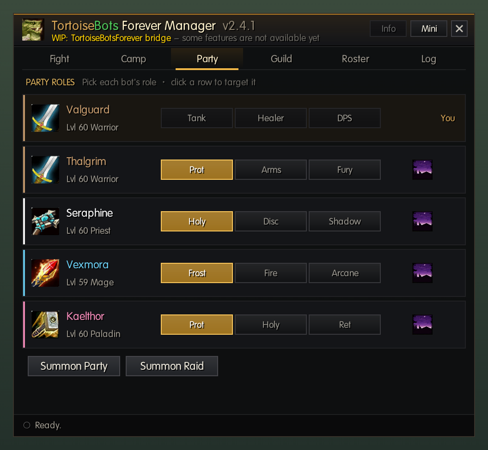
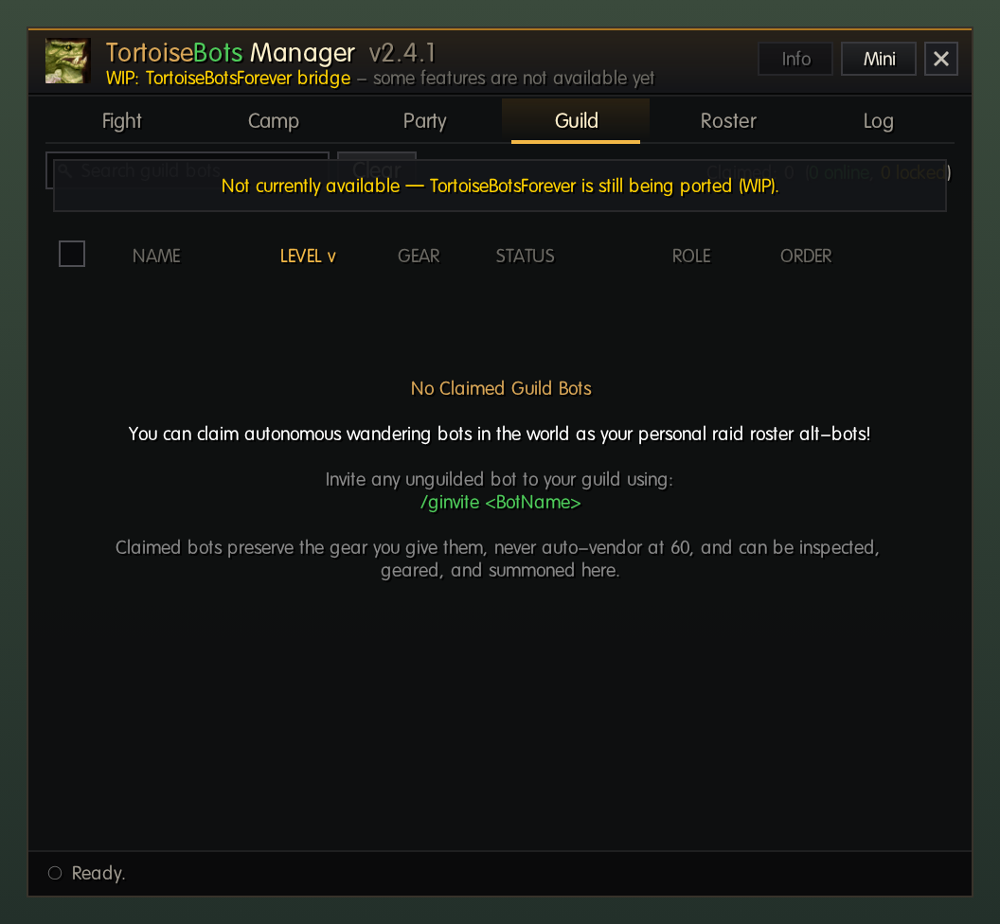

# TortoiseBotsForeverManager

> [!WARNING]
> **Work in progress.** Many features do not work yet. The server side,
> [TortoiseBotsForever](https://github.com/TortoiseBots/TortoiseBotsForever), is still being ported, so the addon
> greys out everything the server cannot do yet. Hover a grey button: it says **Not currently available**.

The in-game control panel (`/tbfm`) for **TortoiseBotsForever**, the bots for **WoW Forever** on
**ForeverCore**. It is TortoiseBotsManager, the panel of the Tortoise WoW bots, ported to the WoW Forever client.

The bots live in the server, so this addon only works on a ForeverCore server that runs the **TortoiseBotsForever**
module. Problems, bugs and requests go to
[TortoiseBotsForever](https://github.com/TortoiseBots/TortoiseBotsForever) too.

This is an unofficial, community project made for educational purposes, not affiliated with Blizzard Entertainment
or the WoW Forever project.

## What works today

Once the server advertises its native verbs (`TBM:VERBS`) and capabilities (`TBM:CAPS`), **non-GM players** can drive the supported panels natively over the `TBM` addon channel (and GM accounts also keep `.tb` bridge fallbacks for remaining commands while `tb-gm` is advertised):

| Where | What |
| :--- | :--- |
| Fight tab | Attack, Pull, Pullback, Focus (your target), End pull, Follow, Stay, Come, Free, Use (your target), Spread / party switches (when `behavior` is advertised) |
| Party tab | Bot role (tank, healer, DPS), Summon, Kick, Log out, Blessings board & per-player exceptions (`blessing`, `blessing-player`) |
| Bot panel | Gear & Bags (`inv`, `item equip`/`unequip`/`give`/`trade`), Behaviour toggles (`behavior`), Shaman totems (`totem`), Class choices (`choice`: aura/aspect/sting/curse/pet/poisons), Mage/Warlock services & portals (`service`), Professions & recipes (`professions`), Auto-gear, Upkeep, Craft orders |
| Loot tab | Loot & roll history (`lootlog` / `loot-log`) |
| Guild & Orders | Guild orders (Farm, Buy, Craft, Cancel, Active orders list; search/enchants/meet/rank stay grey) |
| Camp tab | Rest, Repair, Sell, Train, Release, Accept quests, Drop totems (`totem`) |

Orders go to the bot you target, or to the whole party when you target nobody in it. Attack, Pull, Pullback,
Focus, Rest and Use need the party bound to you; without a target, Attack and Pull fall back to the party orders.

Everything else not yet advertised by the server stays greyed out with a **Not currently available** tooltip (such as
guild roster sync, order search/enchants/meet/rank, dungeon runs, the raid tab, formations, tactics and server info).
They come back by themselves as the server advertises each verb and capability.

## Screenshots

How the panel looks today on a TortoiseBotsForever server (grey = not available yet).

| Fight | Camp |
| :---: | :---: |
|  |  |
| **Party** | **Guild (WIP)** |
|  |  |

The pictures come from the offline preview renderer (`tools/preview`), not from the game client.

## Install

1. Download this repository as a zip (**Code → Download ZIP**).
2. Extract it into `World of Warcraft/_forever_/Interface/AddOns/` and rename the folder to
   `TortoiseBotsForeverManager`, so the path is `Interface/AddOns/TortoiseBotsForeverManager/TortoiseBotsForeverManager.toc`.
3. Start the game and type `/tbfm`.

After an update, restart the game fully: new addon files load only on a restart, not on `/reload`.

## Commands

| Command | What |
| :--- | :--- |
| `/tbfm` | Open or close the panel |
| `/tbfm mini` / `full` | Small fight bar or the full window |
| `/tbfm settings` | Window options |
| `/tbfm resetpos` | Move the window back to the centre |
| `/tbfm trace` | Show every message the addon sends and receives in chat (again to turn off) |
| `/tbfm fake` | Offline demo: a fake server answers, nothing leaves the client |
| `/tbfm status` | Trace, demo and transport state |
| `/tbfm help` | All commands |

## For developers

- `PROTOCOL.md`: the addon ↔ server protocol, the same as TortoiseBotsManager 2.4.1.
- `PORT-NOTES.md`: what changed for the modern client API and what still needs a check in the game.
- `Forever.lua`: the bridge to the server's `.tb` test commands while the full protocol is missing.
- Tests: `lua5.1 tests/regression.lua .`, `lua5.1 tests/lint.lua .`, `sh tests/ui_smoke.sh .`

## Credits

- TortoiseBotsManager by Sagiroth ([TortoiseBots/TortoiseBotsManager](https://github.com/TortoiseBots/TortoiseBotsManager)).
- Port to the WoW Forever client by [waterys419](https://github.com/waterys419).

MIT licence, see `LICENSE` and `NOTICE`.
